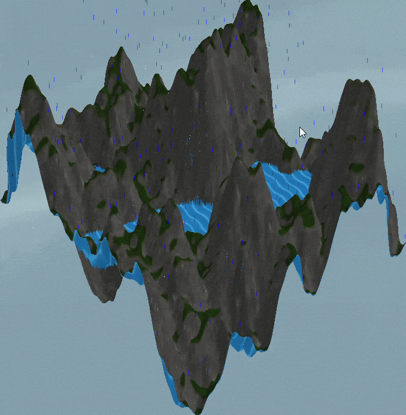

# MathHacks2.0-Terra Megaannum-
### A simulated environment with realistic conditions, over long periods of time to educate about erosion.  


MathHacks 2.0

Using Ursina's library/game engine, we are able to create a terrain simulator that ranges over a long period of time.
This simulator takes math calculations and numbers to model and render a 3D terrain and its changes over many different conditions.


Members:
Edward Zhang - Simulations; hardware

Diego Conda: Height and texture map to 3d Render; ui; resolutions

Eric Xu: Visual Effects; Functions; 

Idan Landa: Water


**Features:**

Simulates terrain by rendering a height and textured map with the area's lengths and heights, and then running multiple calculations for each condition (erosion, river erosion, tectonic plates).

Environment conditions: Erosion, River erosion, evaporation, tectonic plates, fire, vegetation, snow

Hardware connection, so you can affect the system by playing with hardware in real life.

Likelihood and analysis to show predictions and the estimated correctedness.

Plotting different graphs and plots to see changes made by the environment conditions.

Noise map generator

Weather, climate temperatures, freezing waters

The worst UI known to man

Preview to see original version

Likelihood/Uncertainty map:


History map:


Changed Map:


**Fixes we did:**

- Replaced Ursina’s mesh builder with NumPy calculations that rebuild terrain around 40 times faster by processing the whole grid together and reusing triangle connections and texture coordinates.
- Height being rounded since PNG's are 8 bit (0-255), so height is converted to decimals at start and never touched by simulation changes.
- Long time steps spiked terrain, so a long step is split into multiple sub-steps to stay stable.
- Likelihood slowed down the simulation since it runs it multiple times, so instead we made it run as a background thread.
- Water getting stuck in small dips. Fixed by filling up each hollow to its max first, allowing water to flow to the edges of the map
- Always 100% likelihood scores. Fixed by scoring land that was affected by -+2 units.
- Jagged pools of water. Fixed by lowering points beside a diagonal step with water.
- Deserts were able to have lakes since it had hollows. Fixed after adding evaporation
- Rain was a constant for everywhere on the map. Changed by merging rain and wind conditions. Basically, wind moves rain, so some spots are more "rained on" and some are less.


How the Simulator’s Calculations Work:

- The simulator updates a grid of terrain heights to model landscape changes and their effects on climate and water flow.

Height and Elevation:

- Heightmap values from 0 to 255 are converted proportionally into elevations between the selected minimum and maximum, currently 0 to 1500 metres.

**Calculation:**

```math
H = H_{\min} + \frac{h}{255}(H_{\max}-H_{\min})
```

Simulation Time:

- Elapsed time adds up the duration of each step, using 365 days per year and 91.25 days per season, while playback speed only changes how quickly the simulation is shown.

**Calculation:**

```math
t_{\text{elapsed}}=\sum_k d_k,\qquad \Delta t_{\text{years}}=\frac{d_k}{365}
```

Soil Creep:

- Soil creep smooths terrain by moving each height toward its four neighbours using a diffusion coefficient of 0.005 m²/year, with smaller internal steps keeping long simulations stable.

**Calculation:**

```math
\frac{\partial H}{\partial t}=D\nabla^2H,\qquad D=0.005\ \mathrm{m^2/yr}
```

```math
H_i^{\mathrm{new}}=H_i+\alpha\left(H_N+H_S+H_E+H_W-4H_i\right),\qquad
\alpha=\frac{D\Delta t}{\Delta x^2}
```

Tectonic Uplift:

- Tectonic uplift raises terrain fastest at the centre, at up to 0.3 mm/year, and decreases to zero at the map edges.

**Calculation:**

```math
U(x,y)=U_0\sin\left(\frac{\pi x}{L}\right)\sin\left(\frac{\pi y}{L}\right),\qquad
H^{\mathrm{new}}=H+U(x,y)\Delta t
```

Seasonal Temperature:

- Sea-level temperature follows a yearly cycle from −10°C to 20°C before adjustments, peaks on day 200, and is averaged over each simulation step.

**Calculation:**

```math
T_{\mathrm{sea}}(t)=T_{\mathrm{avg}}+15\cos\left(\frac{2\pi(t-200)}{365}\right)+\Delta T
```

```math
\overline{T}_{\mathrm{sea}}=T_{\mathrm{avg}}+\Delta T+
\frac{15}{\omega d}\left[\sin\bigl(\omega(a+d-200)\bigr)-\sin\bigl(\omega(a-200)\bigr)\right],
\qquad \omega=\frac{2\pi}{365}
```

Temperature at Higher Elevations:

- Local temperature drops by 6.5°C per 1000 metres of elevation, allowing the simulator to calculate the percentage of grid points below freezing.

**Calculation:**

```math
T_i=T_{\mathrm{sea}}-0.0065H_i,\qquad
\text{below-freezing percentage}=100\frac{\mathrm{count}(i:T_i\lt 0)}{N}
```

Snow Line and Ice:

- Dividing sea-level temperature by 0.0065 gives the elevation in metres where temperature reaches 0°C, above which snow and frozen water are drawn.

**Calculation:**

```math
H_{\mathrm{snow}}=\frac{T_{\mathrm{sea}}}{0.0065}\ \mathrm{m}
```

Wind-Driven Rainfall:

- Wind speeds of 2 to 20 m/s redistribute rainfall toward slopes facing the wind and away from sheltered slopes while preserving the selected average rainfall.

**Calculation:**

```math
U=2+18b,\qquad
w_i=U\left(\cos\theta\frac{\partial H}{\partial x}+\sin\theta\frac{\partial H}{\partial y}\right)
```

```math
P_i=\overline{P}\frac{s_i}{\overline{s}},\qquad
\overline{s}=\frac{1}{N}\sum_i s_i
```

```math
s_i=\max\left(0.15,\ 1+0.25\,(0.5+b)\,\frac{w_i}{\overline{|w|}}\right)
```

Sensor Smoothing and Zero Point:

- Most sensor readings move 20% toward each new measurement, with changes from their saved zero points controlling rainfall and plant growth as well as wind and fire.

**Calculation:**

```math
v_{\mathrm{smooth,new}}=0.8v_{\mathrm{smooth,old}}+0.2v_{\mathrm{raw}}
```

```math
\text{rain multiplier}=\mathrm{clip}\left(1+\frac{\mathrm{sign}(\Delta RH)\max(0,|\Delta RH|-1)}{3},\ 0.25,\ 3\right)
```

```math
\text{fire level}=\frac{|v-v_0|}{\text{distance from }v_0\text{ to the far end of }0\ldots4095},\qquad \text{fire if level}\gt 0.3
```

```math
b=\frac{\text{joystick push}}{30},\qquad m_{\mathrm{light}}=\mathrm{clip}\left(1+2(\ell-\ell_0),\ 0.3,\ 1.7\right)
```

Sensor Temperature Changes:

- The sensor’s temperature change from its zero point shifts the simulated climate, with each Up or Down input adding or subtracting another 0.5°C.

**Calculation:**

```math
\Delta T=(T_{\mathrm{sensor}}-T_{\mathrm{reference}})+0.5(n_{\mathrm{up}}-n_{\mathrm{down}})
```

Percentage of Land Changed:

- Land changed is the percentage of grid points whose current heights differ from their original heights by more than one heightmap unit, approximately 5.88 metres at the current scale.

**Calculation:**

```math
\Delta h_i=h_i-h_{i,0},\qquad
\text{land changed}=100\frac{\mathrm{count}(i:|\Delta h_i|\gt 1)}{N}
```

Percentage of Soil Moved:

- Soil moved compares the total height lost since the start with the original height sum, excluding gains and intermediate movements rather than measuring actual soil mass.

**Calculation:**

```math
\text{soil moved}=100\frac{\sum_i\max(h_{i,0}-h_i,0)}{\sum_i h_{i,0}}
```

Total Soil and Roughness:

- Total soil adds all heightmap values, while roughness uses their standard deviation to measure overall elevation variation rather than local steepness.

**Calculation:**

```math
S=\sum_i h_i,\qquad \overline h=\frac{S}{N},\qquad
\sigma_h=\sqrt{\frac{1}{N}\sum_i(h_i-\overline h)^2}
```

Likelihood Score:

- The likelihood score averages agreement across up to 20 varied runs at points changed by more than two height units, using a tolerance of 25% or one unit, whichever is larger, to measure consistency rather than real-world probability.

**Calculation:**

```math
M=\{i:|\Delta h_i|\gt 2\},\qquad
\mathcal L=\frac{100}{R}\sum_{r=1}^{R}
\frac{\mathrm{count}(i\in M:|\Delta h_i^{(r)}-\Delta h_i|\leq\tau_i)}{|M|}
```

Uncertainty Map:

- The uncertainty map uses the standard deviation of alternative final heights at each grid point to show where the tested simulations disagree most.

**Calculation:**

```math
\overline h_i=\frac{1}{20}\sum_{r=1}^{20}h_i^{(r)},\qquad
\sigma_i=\sqrt{\frac{1}{20}\sum_{r=1}^{20}\left(h_i^{(r)}-\overline h_i\right)^2}
```

River Placement:

- River placement fills hollows to their lowest spill levels to identify potential lakes and routes drainage toward the lowest downhill neighbour among the eight surrounding points.

**Calculation:**

```math
H_i^{\mathrm{filled}}=\max\left(H_i,\min_{p:i\to\mathrm{edge}}\max_{j\in p}H_j\right)
```

```math
r(i)=\mathrm{arg\,min}_{j\in\mathcal N_8(i),\ H_j^{\mathrm{filled}}\lt H_i^{\mathrm{filled}}}H_j^{\mathrm{filled}}
```

River Flow Accumulation:

- Each grid point passes its contributing drainage area downstream, with rainfall runoff weighting the flow used for river calculations.

**Calculation:**

```math
A_i=\Delta x^2+\sum_{j:r(j)=i}A_j
```

Lake Evaporation and Runoff:

- Lake evaporation starts at 700 mm/year at 8°C and increases by 7% per additional degree, while the Budyko curve divides rainfall between evaporative losses and river runoff.

**Calculation:**

```math
E_{\mathrm{lake}}=700\times1.07^{T-8}\quad\mathrm{mm/yr}
```

```math
\frac{ET}{P}=1+\frac{E}{P}-\left[1+\left(\frac{E}{P}\right)^{2.6}\right]^{1/2.6},\qquad
R=P-ET
```

Lake Size and Overflow:

- Lake size balances river inflow and direct rainfall against evaporation while accounting for submerged land, with overflow occurring if the supported water level reaches the basin’s outlet.

**Calculation:**

```math
I+PA_{\mathrm{lake}}=E_{\mathrm{lake}}A_{\mathrm{lake}}
```

```math
A_{\mathrm{lake}}=\frac{I_0}{E_{\mathrm{lake}}-P+R}
```

River and Lake Drawing:

- River depth increases logarithmically with runoff-weighted flow above a threshold based on 0.5 km² of drainage, while lakes are drawn only when at least 0.3 height units deep and 0.1 km² in area.

**Calculation:**

```math
Q_{\min}=\max\left(2,\ \frac{0.5\ \mathrm{km^2}}{\Delta x^2}\right),\qquad
d_{\mathrm{river}}=0.5\left(1+\frac{\log_2\max(Q/Q_{\min},1)}{3}\right)
```

River Erosion:

- River erosion increases with the square root of runoff-weighted drainage area and directly with slope, while plant cover reduces erosion by up to 70% and an implicit height update keeps long steps stable.

**Calculation:**

```math
E_i=K_{\mathrm{eff},i}Q_i^{0.5}S_i,\qquad
K_{\mathrm{eff},i}=K_0(1-0.7V_i),\qquad K_0=2\times10^{-6}\ \mathrm{yr^{-1}}
```

```math
F_i=\frac{K_{\mathrm{eff},i}\Delta t\sqrt{Q_i}}{\Delta d_i},\qquad
H_i^{\mathrm{new}}=\frac{H_i+F_iH_{r(i)}^{\mathrm{new}}}{1+F_i}
```

Sediment Transport and Deposition:

- Eroded sediment moves downstream, depositing a fraction based on cell area divided by drainage area, with lakes trapping material and sediment leaving the map recorded separately.

**Calculation:**

```math
f_i=\min\left(1,\frac{G\Delta x^2}{A_i}\right),\qquad
G=0.5,\qquad D_i=f_iQ_{s,i}
```

Plant Growth and Carrying Capacity:

- Plant cover approaches the maximum supported by local climate and slope through logistic growth at a base rate of 0.15/year, adjusted by the light sensor.

**Calculation:**

```math
C=\mathrm{clip}_{01}\left(\frac{T_{\mathrm{annual}}+4}{6}\right)
\mathrm{clip}_{01}\left(\frac{P-150}{650}\right)
\mathrm{clip}_{01}\left(\frac{55-\beta}{20}\right)
```

```math
\frac{dV}{dt}=rV\left(1-\frac{V}{C}\right),\qquad
V(t)=\frac{C}{1+\frac{C-V_0}{V_0}e^{-rt}}
```

Plant Spreading and Fire:

- Plants spread toward neighbouring cover by at most 25% per update, while each fire halves cover within a radius of 10% of the map width and temporarily weakens erosion protection.

**Calculation:**

```math
V_i^{\mathrm{new}}=V_i+s(\overline V_{\mathrm{neighbours}}-V_i),\qquad
s=\min\left(0.25,\frac{300\Delta t}{\Delta x^2}\right)
```

```math
V_{\mathrm{after\ burn}}=0.5V_{\mathrm{before\ burn}},\qquad R_{\mathrm{burn}}=0.1L
```

Terrain Rendering:

- The renderer builds a surface from two triangles per grid square and updates its heights and lighting normals while reusing triangle connections and texture coordinates.

Water Rendering and Animation:

- A matching mesh draws water above wet ground and hides it elsewhere, using animated wave textures to suggest flow and showing ice above the snow line without calculating physical water velocity.

Procedural Terrain Generation:

- Procedural terrain combines layers of simplex noise with doubled frequency and halved amplitude, then smooths and rescales the result to heightmap values from 0 to 255.

Saved Maps and Charts:

- Saved maps show height loss in red and gain in blue, while charts track terrain changes and temperature over time and the uncertainty map shows disagreement between alternative runs.

River Network and Steady-State Checks:

- River checks compare length against drainage area using Hack’s law and test whether erosion balances uplift, with reported results of a 0.56 river exponent and a 0.97 erosion-to-uplift ratio.

**Calculation:**

```math
L_{\mathrm{river}}=cA^{b},\qquad
\log L_{\mathrm{river}}=\log c+b\log A
```

```math
U=K_{\mathrm{eff}}\sqrt Q\,S,\qquad
S=\frac{U}{K_{\mathrm{eff}}\sqrt Q}
```

  For libraries: python -m pip install -r requirements.txt

